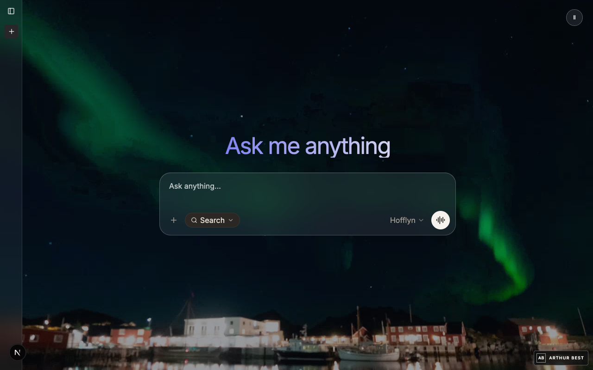

# Hofflyn — Motion Chat



A motion-driven AI chat agent built with Next.js, featuring a glimmer hero, motion backgrounds, and a Hofflyn-branded interface.

## Getting Started

### Prerequisites

- Node.js 18+ (recommended: Node 20)
- npm

### Install

```bash
npm install
```

### Run (development)

```bash
npm run dev
```

Open [http://localhost:3000](http://localhost:3000) in your browser.

### Production build

```bash
npm run build
npm start
```

## Deploy to GitHub Pages

This repo includes a GitHub Actions workflow (`.github/workflows/deploy.yml`) that builds and deploys the app to GitHub Pages automatically on every push to `main`.

To enable:
1. Go to **Settings → Pages** in your GitHub repo
2. Set Source to **GitHub Actions**
3. Push to `main` — the workflow will build and deploy

## Component Library Reference (Aura.build)

Use these links when adding UI components to the app.

| Component | Link |
|-----------|------|
| Hero | https://www.aura.build/components?componentType=free&q=Hero |
| Store | https://www.aura.build/browse/components?q=store&page=1 |
| Code | https://www.aura.build/components?componentType=free&q=code |
| Section | https://www.aura.build/components?componentType=free&q=Section |
| Button | https://www.aura.build/components?componentType=free&q=Button |
| Card | https://www.aura.build/components?componentType=free&q=Card |
| Background | https://www.aura.build/components?componentType=free&q=Background |
| Header | https://www.aura.build/components?componentType=free&q=Header |
| Logo | https://www.aura.build/components?componentType=free&q=Logo |
| Feature | https://www.aura.build/components?componentType=free&q=Feature |
| Pricing | https://www.aura.build/components?componentType=free&q=Pricing |
| Testimonial | https://www.aura.build/components?componentType=free&q=Testimony |
| Footer | https://www.aura.build/components?componentType=free&q=Footer |
| Form | https://www.aura.build/components?componentType=free&q=Form |
| Heading | https://www.aura.build/components?componentType=free&q=Heading |